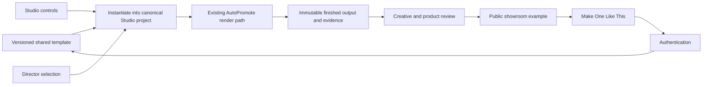

# AutoPromote creative showroom and shared template contract

17 October private AI-human test: [the eight-second generated character/voice, selected native movie, complete matching Studio playback and editable backup](../reports/studio-human-demo-20261017/README.md). Exactly one Veo 3.1 Fast 720p/24fps video-with-dialogue request completed, estimated $0.80; no GPU instance restart. Normal signed-in source import, native 16:9 framing, three editable disclosure/subtitle layers, history and exact cold reopen pass. Two CPU exports are retained: the selected separate project bypasses default voice repair and preserves generated dialogue at zero-offset decoded correlation 0.998352/gain 0.984546. All compiled titles, exact owned source and completed-job output hashes, 192-frame full decode, full eight-second timeline playback and independent native backup restore pass. Two cached local ASR engines recover the requested line. This is private external-provider source generation imported into Studio, not a common-runtime/customer lip-sync integration or approved welcome-page/showroom asset. Perceptual lip sync, human sound/creative approval, capture smoothness and whole predictive picture/sound remain unqualified. One generation only; no new scheduling, deployment or main merge. Formal counts stay 2 UNIMPLEMENTED / 1 BROKEN / 9 PARTIAL / 17 FUNCTIONAL / 0 PRO-READY / 0 PRODUCTION-READY. Next: owner character/voice review before the longer story using real Studio/Publisher/Queue recordings; preserve shared S04 spatial/path, S03 occurrence/group and S02 picture/sound/export-latency priorities.

17 October owner follow-up: schedule standalone results for every already published/queued Studio recording in this series. All nine matching native finals now have 54 verified active once-only destination schedules for 18–20 October SAST: Coffee, Cycling, Headphones, sliced type, five words and the four daily motion studies. Eighteen paused original final destinations are edited/rescheduled/resumed through Queue while preserving their IDs; six missing finals use normal five-destination Publisher with independent times and owned-media Reddit reuse. Cold read-only Queue/source checks verify 54 exact native hashes, platform copy/times, zero duplicate active result/platform destinations, all 54 original recording entries and 26 prior upcoming schedules, including both selected logos. [Coverage, schedule table and exact receipts](../reports/daily-studio/2026-10-17/standalone-results/publishing/README.md). Provider publication remains separate. No render, paid job, main merge, deployment or readiness/showroom promotion. Formal counts and S04 spatial/path, S03 occurrence/group and S02 picture/sound/export-latency limits remain unchanged.

17 October owner selection: “schedule both.” Spring assembly is scheduled on 18 October and Diamond cascade on 19 October through normal signed-in Publisher, with twelve active once-only destinations across the six platforms and independent copy/times. Two native AAC uploads are reused for ten destinations. A fresh read-only Queue load verifies all twelve scheduled source hashes, exact captions/times, no duplicate version/platform destinations and preservation of 15 earlier upcoming schedules. Original movies/projects/backups remain unchanged; IDE copies and Studio recordings stay private. [Schedule table and receipts](../reports/daily-studio/2026-10-17/logo-comparison/publishing/README.md) supersede the earlier A/B selection wait. Scheduling is verified; provider publication is separate. No new render, paid job, main merge, deployment or readiness/showroom promotion. Shared S04/S03/S02 priorities and exact product/parity/listening/smoothness limits are unchanged.

12–13 October publishing continuation: [three full Studio recordings, six-post campaign, exact queue/media receipts and remaining limits](../reports/model-capability-runtime-v1-20261009/STUDIO-PUBLISHING-DELIVERY-20261012.md). Thirty-six owned pending one-time destinations are saved through Publisher for 13–18 October at 18:00 SAST. Connection/destination/own-brand handling, bounded queue periods/pagination and unchanged-source duration recovery are repaired. Coffee/headphones recordings are renewed without rendering. Future dispatch/provider acceptance remains unverified; no showroom/hero or readiness promotion. Zero new renders/models/GPU jobs, production deployment or main merge. Continue shared S02, then S03/S04.

Latest 11 October compositing continuation: [native blend edit, complete Studio movie/timeline, exact recovery and limits](../reports/model-capability-runtime-v1-20261009/NATIVE-LAYER-BLENDS-20261011.md). Normal/Multiply/Screen/Difference now export for ordinary flat overlays; unsupported modes fail explicitly. One179.565s CPU export/download/full playback and exact backup restore pass;417 later frames and all decoded audio match the prior export.Owned immutable export adoption and renewed access now pass same-job cold recovery/download/full decode with the worker offline.127 scoped checks and strict local build pass. Owned CPU workers stopped;zero new model/GPU jobs, deployment or main merge. Whole live parity, global ordering/nesting, remaining controls and creative/public qualification stay open; no readiness promotion. Continue S02, then bounded S03/S04.

Private editing continuation (11 October): [native value graphs, actual motion/SFX exports and recoverable editable projects](../reports/model-capability-runtime-v1-20261009/VALUE-GRAPH-AND-PLAYBACK-20261011.md). Two complete Studio timeline films and a fresh-store owned backup restore pass. These are private editing evidence; full predictive picture/sound, human creative review and public-release approval remain unqualified. The public catalogue/hero remain empty; no welcome-page redesign or deployment.

Latest 11 October cut/audio continuation: [actual repairs, native timeline and retained failures](../reports/model-capability-runtime-v1-20261009/CUT-HANDOFF-AUDIO-CLOCK-20261011.md). Prepared cuts commit synchronously, three bounded decoders prepare two cuts ahead, hidden Before decoding is released in After-only mode, audio preparation is Pause-cancellable, and music/overlapping cues share the audio clock through ready cuts.15 focused checks and the normal build pass. Unrecorded source:20.304s, zero waits,7.693s preparation,56ms click-to-playing. Live mix:20.235s/all17 cues; music windows0.999765–0.999999, but whole opening/14s sound remains different. Later direct recording reproduces44.384s with a long initial wait and failing opening signal; retained without reclassification. Whole S02 remains unqualified; S03 and the S04 After Effects timeline follow. No new render/model/GPU job, readiness/creative/public promotion.

Latest 11 October speed-ramp continuation: [complete Studio movie/timeline, real music-clock repair and remaining blockers](../reports/model-capability-runtime-v1-20261009/SPEED-RAMP-20261011.md). A separate native project retains linear7s:1×/8s:2×/9s:1× keys after cold reopen. Two CPU exports produce identical465-frame24fps output (19.375s picture/19.385s stereo audio). Full native finished-film playback is1× with zero waits/drops during the run. Duplicate-refresh transport, completed-file speed reapplication, source rate updates and retimed music clock are repaired. Actual music capture shows30→14 starts, constant1× and8s bed correlation0.078→0.9999; whole mix/listening remains unqualified. Source loading remains variable (11.289s preparation;22.312s run), and live rate observations retain at most0.125× interval lag.Synthesized cue rate changes now continue the same buffer; real capture observes17 cues and21→18 built-in starts/resumes, with one45.8ms-late callback still open.43 distinct focused checks and the normal build pass. CPU worker stopped;zero model/GPU jobs and no readiness/creative/public promotion. Continue S02 buffering/live cut timing, SFX/VO/ducking/trim and live raster/staging; then S03. Earlier checkpoints below are historical.

Latest 11 October SFX edit: [actual new movie, full Studio timeline, exact sound/picture evidence and blockers](../reports/model-capability-runtime-v1-20261009/SFX-AUTOMATION-20261011.md). Active built-in cue gain now follows the SFX bus keys, and adding a key preserves neutral/current bus gain instead of applying the fader twice. The normal App duplicates/edits/saves/cold-reopens the thirteen-cut project and performs one CPU export/download:20s/480frames, unchanged decoded picture, new sound envelope. Finished-film Studio playback has zero waits/drops and its full timeline recording is retained. Separate predictive sound capture takes25.536s and fails early music comparison; those failures remain open. A later unrecorded native source run takes21.044s with two short waits,1.066s preparation and481 frame callbacks; it does not reproduce the five-second first-shot pause or qualify full mix/parity. Three focused component checks pass (104 skipped), ordinary build passes. CPU worker stopped; zero model/GPU jobs, no readiness/public/creative promotion. S02 title raster diagnostic has started; initial source wait/full mix, white/colour raster/staging and retiming remain next, then S03. Prior checkpoints below are historical.

11 October sound continuation: [actual native live mix and editable Studio timeline](../reports/model-capability-runtime-v1-20261009/CYCLING-STUDIO-RECOVERY-20261011.md) preserve the same private cycling project/export. Running music and cancelled late SFX resume are verified; all17 cues are observed in20.757s, with music-bed comparison0.902–1.000. Native sound controls pass and the full timeline is shown beside a resolved source frame. This is scoped engineering evidence, not full sound/creative approval. The public catalogue remains empty; no new film/render/model/GPU job, deployment or release. S02 live picture/full mix qualification and the normal-account runtime backlog remain open.

Permanent product requirement established **9 October 2026** by the founder.
Read alongside `STUDIO-COMPLETION-CONTRACT.md`. This requirement expands the
audience for the shared creative system; it does not replace the model runtime,
canonical Studio, provenance, authorization or deterministic render contracts.

## Product principle

**SHOW THE RESULT BEFORE EXPLAINING THE FEATURE.**

The public welcome page is a creative showroom. Visitors must see desirable,
professionally finished AutoPromote creations before signing up. A generic
SaaS page of feature copy, icons, screenshots or technical demonstrations does
not satisfy this requirement. The intended response is: “I want AutoPromote
to make this for me.”

Demonstrate a reference image becoming a living cinematic scene, typography
tracking through an actual shot, a premium 3D logo/product reveal, and raw
footage becoming a finished story. Category names and technical claims do not
substitute for those visible results.

## One template, multiple uses

`product_launch_cinematic_v1` is an example shared template identity. Its one
versioned definition must support a public demonstration, a Studio starting
template, a Director-selected template and an editable customer project.

Keep the template ID, exact version and definition hash attached to its
instantiated project, source bindings, render request, finished output and
review evidence. Do not silently substitute a different version. Template
definition changes require a new identity/hash and renewed qualification;
published approved definitions and releases must remain immutable.

Templates must produce ordinary editable clips, layers, keys, effects, audio
and revisions inside the existing project. The welcome page consumes finished
outputs of this same system. Do not create a marketing-only animation engine,
hand-coded demo film, alternate editing graph or browser simulation and call
it product output. Existing deterministic paths and Cam Combiner remain
authoritative; model requests use the common Model Capability Runtime.

## Eventual showcase categories

1. Image → cinematic moving scene
2. Idea → finished promo
3. Founder story
4. Product launch
5. Cinematic logo reveal
6. Motion graphics
7. Text behind subject
8. Tracked graphics
9. Background replacement
10. Object cleanup/replacement
11. AI-generated humans moving/talking
12. 3D product/logo scene
13. Podcast → vertical promo
14. Long video → viral short
15. Before/after creative transformation
16. Script/screenplay → generated scene
17. Cinematic sound design
18. Brand trailer

These are requested future coverage, not claims of current availability.
Each category stays planned until its real qualified template and approved
outputs exist. A generated person talking also requires verified speech/lip
synchronization evidence; a moving person alone does not demonstrate talking.
Model-backed claims require owned, attached, attested runtime artifacts. An
image-to-video example must have image-conditioned generation evidence, rather
than text-to-video relabelled as image transformation. Unintegrated capabilities
remain unavailable for public claims.

## Showcase quality and publication gate

A technically successful render is insufficient. A public candidate needs:

- A professionally finished result that clearly demonstrates its claimed
  capability, has a strong before/after or transformation and is something
  the founder would actually post publicly.
- A qualified shared template and the normal authenticated, editable Studio
  lifecycle. All twelve product gates and relevant preview/final parity remain
  mandatory. A signed-out fixture or standalone script is insufficient.
- A canonical project whose hash/owner match the template execution; an exact
  request-bound completed output from the existing renderer; a complete decoded
  movie with its output clock/frame count verified.
- A trusted human creative review of the full moving video and soundtrack,
  bound to that exact template/project/render/output and the before/poster media.
  A test fixture, automated score, logs, contact sheet or matching checksum cannot
  establish professional creative quality.
- Explicit public-release permission for the finished output, the poster and
  the before material. Verify exact immutable public copies, their hashes,
  object generations and source/derivation ownership. Keep private project,
  owner, prompt, source URL and model implementation details out of public data.

Rejection or any template/project/media change invalidates approval. Rejected
earlier logo/combined films remain rejected; their technical receipts cannot
promote them. Never fill an empty category with a weak demo to populate a grid.

Public assets are static immutable copies selected from approved releases.
Watching a showcase must not run models or allocate a GPU. The review gate is
implemented as a server-side policy; no browser-supplied boolean grants approval.
Actual publication must respect existing approval/authorization and deployment
boundaries. This work does not deploy to production or merge to main.

## CTA and authentication behavior

Each qualified example eventually offers **WATCH EXAMPLE** and **MAKE ONE LIKE
THIS**. The first plays that exact approved output. The second retains only a
safe workflow/template/version/hash/showcase identity across the existing login,
registration, verification and terms flow.

After authentication, the server must resolve the active approved release and
exact qualified template again. Open the appropriate Studio workflow, create a
fresh project owned by that authenticated customer and bind the customer's own
inputs. Preserve the selected identity across login; do not send users to an
unrelated generic dashboard or silently choose a similar template. Withdrawn or
unavailable versions require an explicit unavailable result.

Public examples do not transfer the creator's private project/media ownership to
the customer. Clicking, authenticating or opening a template must not silently
start paid generation. Existing authorization, entitlement and cost approval
checks remain authoritative before a job is requested.

## Hero film

Choose one of AutoPromote's strongest completed, reviewed creations. The full
film must immediately demonstrate **story, cinematography, generated video,
motion, sound, VFX, 3D, editing and brand payoff**. Finish with **“Made with
AutoPromote.”** or a deliberately reviewed equivalent, visibly rendered into
the actual final movie. The viewer discovers that the product being advertised
produced the film they just watched.

A first deterministic product-promo sample does not automatically qualify as
this hero. Hero approval requires all of the above demonstrations and backed
generated footage in the same actual canonical project/output. Do not relabel a
UI tour as a cinematic hero or add a page caption to imply an absent end card.

## Implemented foundation and remaining work

Added on the isolated branch:

- `contracts/creative-templates-v1.json`: strict versioned template, reference,
  registry and public-release/candidate-catalogue contracts.
- `config/creative-templates/registry.v1.json`: eighteen planned categories and
  the draft first product-launch template, with Studio/Director/welcome surfaces.
- `config/creative-templates/showcase.v1.json`: an intentionally empty candidate
  catalogue and no hero. It publishes no rejected or fictional media.
- `src/creativeTemplates/contract.js`: exact definition-hash resolution and
  qualification checks.
- `src/creativeTemplates/showcase.js`: immutable evidence/creative approval gate,
  safe public-manifest projection and an authenticated, pinned fresh-project
  workflow-intent resolver. These are policies, not a deployed publisher.

The gate depends on trusted server adapters. `evidenceStore.get(hash)` must read
immutable canonical/template/render/review/lifecycle records. Its
`verifyModelExecution(artifact)` must validate the actual owned runtime job,
attempt/worker/model/source attestation; it cannot trust client flags.
`publicMediaStore.verify(media, scope)` must check exact bytes/hash/type/size,
immutable object generation, derivation and approval/public permission. A path
format alone does not establish that a file exists or may be published.

The template-instantiation adapter is now implemented in the shared Studio kernel. Three distinct private 20-second outputs use the same exact draft definition. The signed-in local App exercised the first instance's apply/edit/replace/timing/easing/history/save/cold-reopen/render/download lifecycle; Director selected/reviewed/applied the same adapter and ordinary manual editing continued afterward. [Actual films, project files, hashes and limits](../reports/model-capability-runtime-v1-20261009/LAUNCH-TEMPLATE-DELIVERY.md).

10 October follow-up: every edited film is delivered with its actual Studio project and full editable timeline. [Three upgraded movies, native Studio playback recordings with sound, project backups, material inventory and exact limits](../reports/model-capability-runtime-v1-20261009/MATERIALS-EDITING-20261010.md) now exist. All three native downloads match owned completed-job hashes; VELO/ONDA cold recovery and actual finished-file playback passed. These private technical deliveries grant no professional creative acceptance, predictive audio parity or public permission.

Production store/publisher adapters, the authentication-to-template showroom handoff and public welcome-page media wiring remain incomplete. Full moving-film/sound creative review, founder acceptance and whole predictive preview/final parity remain unqualified. Local charging was bypassed by the existing development configuration. These native private exports do not qualify public releases or the hero, and the public catalogue remains empty. The current welcome page retains its existing tour/screenshots/features; no production page was changed.

11 October continuation: the same private cycling export now plays fully with its native timeline, survives owned backup/receipt recovery and cold reopening, and its real live preview sound is captured separately. Source loading, transition staging and music/cue clocks are repaired within the existing Studio. Bounded accurate paused-source-frame geometry now passes 46/0/1 at 2px on the same 47 samples, with black agreement. Exact live frame delivery, full text/matte/grade/sound and creative approval remain unqualified. Two music sync trials fail signal checks and are reverted; no new film, model/GPU job, public example or hero is claimed. [Film, timeline, sound and exact limits](../reports/model-capability-runtime-v1-20261009/CYCLING-STUDIO-RECOVERY-20261011.md).

Next action: review the actual private movies with sound, revise the shared template where the creative result fails, then pair relevant preview/final picture and sound. Only after qualification and explicit public-release permission should the exact accepted output become a showroom candidate. Preserve the outstanding model-runtime lifecycle work and shared Studio S02 backlog.

Playback/source follow-up (10 October 2026): the founder likes the clean timeline but has not accepted the films as professionally finished. [Native playback measurements and the next continuous-source edit](../reports/model-capability-runtime-v1-20261009/CREATIVE-PLAYBACK-AUDIT-20261010.md) record an unresolved headless Studio frame-delivery problem; the unsuccessful playback trial was reverted. No new template/output or public approval was created.

Native playback repair (10 October 2026): [the same VELO film now plays with 1 dropped frame and an updated real Studio/timeline recording](../reports/model-capability-runtime-v1-20261009/STUDIO-PLAYBACK-REPAIR-20261010.md). The full-screen backdrop bottleneck is repaired in the ordinary local build. Project/movie hashes and timeline layout are retained. This qualifies the measured finished-file playback slice; predictive editing preview, creative/sound acceptance and public release remain unqualified. Next is the continuous-source cycling edit through native controls.

10 October private creative continuation: [one vertical cycling edit and its actual full Studio timeline](../reports/model-capability-runtime-v1-20261009/CYCLING-RHYTHM-20261010.md) now use the shared pinned `cycling_rhythm_v1@1.0.2` adapter and canonical renderer. This is a private review output. Exact owned export recovery and native full-film playback pass; raw-source switching latency and native browser download remain blockers. Founder full-film/sound acceptance and full picture/audio parity remain unqualified. No public candidate/hero, production wiring, deployment or GPU/model execution is added.

10 October playback follow-up: [source-preview repair and native download](../reports/model-capability-runtime-v1-20261009/SOURCE-PREVIEW-REPAIR-20261010.md) preserves the existing private cycling project/film. Repeated raw-source playback has fewer waits; bundled Chromium can download the exact completed output. Installed Chrome153 download crashes, whole predictive picture/sound parity and creative review remain open. No new film, GPU execution or public release; the showcase catalogue remains empty.

11 October loading/cue continuation: [32 scoped checks, actual native measurements and remaining failures](../reports/model-capability-runtime-v1-20261009/SOURCE-AUDIO-LOADING-20261011.md). The same private film/project remains; no additional creative output or public qualification. Full mix and variable source loading remain open. The founder reaffirmed the After Effects timeline requirement; it stays on the same canonical system after shared conformance/composition work.

11 October native keyframe/sound delivery: [the actually edited and exported cycling film with full native timeline](../reports/model-capability-runtime-v1-20261009/NATIVE-KEYFRAMES-RETIMED-SOUND-20261011.md) now exercises property/key editing, inspector selection, frame nudging, history, cold recovery and a real CPU export/download. Retimed audio, media timeline visibility and bounded fullscreen composition are repaired.48 scoped checks pass. Full predictive conformance, professional moving-film/sound acceptance and public release remain open; the catalogue and hero stay empty. No new model/GPU execution or deployment.
