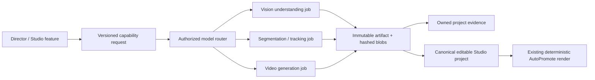

# Model Capability Runtime V1

The existing Studio subject-effects panel can submit its saved generic mask reference through `/studio-subject-vfx`. The backend resolves project/source/hash/generation/prompt bindings and dispatches deterministic composition to the existing worker protocol in `model_artifact_cpu` mode. `STUDIO_MODEL_VFX_URL`/`STUDIO_MODEL_VFX_SECRET` configure that CPU worker. Its separate image definition has no CUDA, Torch or weights. Preview review and the existing final export resolver retain their contracts; no new model inference is needed for effect-only edits. [Follow-up evidence and unqualified authenticated lifecycle](../reports/model-capability-runtime-v1-20261009/SUBJECT-BRIDGE-FOLLOWUP.md).

Branch: `agent/model-capability-runtime-v1`. The inherited Studio working source
was preserved in baseline commit `2aaec02b`; runtime changes follow that commit.
No production service is deployed, no production feature flag is changed, and
Cam Combiner synchronization and the deterministic final renderer remain the
authorities for their existing responsibilities.

The router has no model imports. A client requests a capability and parameters;
it cannot select a checkpoint, a container, a CUDA device or a fallback provider.
Model replacement changes the server registry/worker configuration while
retaining the capability input/output contract. Unsupported contracts fail
explicitly. There is no successful placeholder output or browser approximation.

## Contracts and registry

`contracts/model-capabilities-v1.json` contains strict request, parameter and
output schemas. All time ranges are half-open source ranges on Studio's 90,000
tick clock. Normalized processing media uses CFR 24 fps, has its own persisted
byte hash, and is explicitly a derivative of the original source; masks are
bound to that derivative, not transferable to arbitrary source dimensions or
frame clocks. Original owner/source hash/range/generation remain in the parent
artifact. Understanding is **sampled-frame evidence**. Detection describes one
frame. Segmentation/tracking describe decoded frames of the processing asset.
These coverage types must not be conflated.

`config/model-runtime/registry.v1.json` records model family, exact checkpoint,
immutable upstream revision and weight SHA-256 values, license/commercial-use
status, device/VRAM planning estimate, preferred GPU, specialized worker/runtime,
schema references, timeout, retry/fallback policy and model version.
`sources.v1.json` locks the exact files prepared for inference. The private
deployment registry resolves the worker image to an immutable container digest;
every request/artifact captures the actual resolved image. Estimates do not
claim measured VRAM; receipts carry measured peaks.

| Capability | Initial implementation | Worker | Result |
|---|---|---|---|
| `understand_video` | Qwen3-VL 4B Instruct | vision-understanding | `scene_understanding.json`, sampled frames |
| `detect_object` | Grounding DINO tiny | vision-understanding | `object_detections.json`, normalized boxes/scores |
| `segment_subject` | SAM2.1 Hiera small | segmentation-tracking | mask PNG bundle, mask manifest, source derivative |
| `track_object` | Deterministic geometry of real SAM2 masks | segmentation-tracking CPU | `tracking_path.json`, visibility/centroids/boxes |
| `generate_video` | Wan2.2 TI2V 5B | video-generation | native moving `generated_shot.mp4` |

TAPNext++ is a distinct pinned, disabled registry entry. V1 object-mask centroids
are **not physical point correspondences**. Requests for point tracking return
unavailable until that adapter is integrated/qualified; they never fall back to
centroids under a false TAP label. SAM2 segmentation is not dedicated hair matting
or metric depth. Wan results are generated illustrations requiring review, not
recordings of the source people/events. Neural confidence is omitted when it is
not meaningful/calibrated; DINO model scores remain per detection.

Primary checkpoint cards/license sources:
[Qwen3-VL](https://huggingface.co/Qwen/Qwen3-VL-4B-Instruct),
[Grounding DINO](https://huggingface.co/IDEA-Research/grounding-dino-tiny),
[SAM2.1](https://huggingface.co/facebook/sam2.1-hiera-small),
[Wan2.2](https://huggingface.co/Wan-AI/Wan2.2-TI2V-5B-Diffusers), and
[TAPNext++ / TAPNet](https://huggingface.co/google/tapnet).

## Authorization, durability and concurrency

New `/api/media/studio-capabilities` routes remain behind existing Firebase
authentication, admin/founder UID allowlist and tester feature authorization.
`STUDIO_MODEL_RUNTIME_ENABLED` is disabled by default. The product adapter
verifies the source binding, registered canonical project revision, owned
storage object, immutable generation and hash metadata. The worker checks the
actual downloaded bytes and owner metadata again. This phase accepts source
video; image ingestion needs a corresponding owned-media binding adapter.
Image-to-video can condition on the first frame of that verified video.

Requests are immutable fingerprints of owner, request ID, source generation,
capability/parameters and model revision. A reused ID with different content
conflicts. Queued work rechecks ownership/source/revision before dispatch.
Model dependencies are owned, hash verified and bound to the same project/source.
Mask tracking additionally requires the exact mask subject/range. Workers cannot
publish results for a different job/request/attempt. Actual output blobs are
independently hashed before publication.

Firestore holds the durable job journal and one global GPU-capacity record for
these workers. Capacity has no time-based automatic release. It is released
only after Cloud Run reports task termination or a dispatch is known to have
been rejected before execution. Lost dispatch responses stay uncertain and are
reconciled through their request identity in execution overrides. No automatic
`:run` retry or automatic regeneration occurs. Cloud Run uses one task, one GPU,
parallelism one and retry count zero. Cancellation retains capacity until actual
termination. Artifact publication and job completion share a Firestore
transaction, preventing a late cancellation from publishing orphan evidence.
Queued requests retain their original image digest. Dispatch rejects a changed
worker configuration and supplies the checked resource ETag to
[Cloud Run's run request](https://docs.cloud.google.com/run/docs/reference/rest/v2/projects.locations.jobs/run).
Completed execution images are checked against the sealed job before evidence
publication; replacing an image cannot falsify an older artifact's provenance.

Artifacts include project/source identity, original source hash/range, model and
checkpoint revision, registry/model versions, parameters/config hash, dependency
hashes, immutable blob generations/hashes, result status, creation time,
confidence where meaningful, worker code/image provenance and GPU/runtime/RSS
metrics. Review decisions belong in separate records; changing an edit does not
mutate the artifact. Results from obsolete project revisions are retained as
stale and cannot silently apply to current state.

`FileStore` is a **single-process development/proof transport**, not the
multi-replica production journal. Production uses the Firestore adapters.
The private CLI proof uses this transport and an isolated proof owner/project;
it does not qualify ordinary-account authorization or the twelve Studio gates.

## Studio / Director integration

Canonical `analysisRefs` now accept model-capability artifact references without
checkpoint/router details. They survive projection/reload. Registering a
revision verifies that each reference exists, belongs to this owner/project and
matches its source asset/range/capability. Subject effect layers retain immutable
mask/tracking references alongside their existing editable scene/effect controls.
Generated shots enter ordinary project media with generation provenance, rather
than a separate editing engine.

Project intelligence accepts `model_artifact` references only after verifying
their stored hash and exact owner/source/dependency/model identity. Existing
human-declaration write rules remain; a client cannot label assertions as
model-inferred or human-verified to manufacture evidence. Director consumers use
verified artifact outputs and their coverage/uncertainty. Merely carrying a model
name, a prompt or a model-generated assertion is not source evidence.

Existing per-feature private SSH/VFX providers are preserved for compatibility;
the new runtime does not pretend those legacy paths have all migrated. Further
feature wiring must use capability requests and reusable artifacts. Canonical
state additions change no visual design, Cam Combiner or synchronization logic.

## Workers and scale-to-zero operation

Each Dockerfile copies only its specialized adapter. Images contain inference
libraries, never all checkpoint weights. Models are streamed to a private GCS
cache by a CPU preparation job and loaded only when requested. Cache publication
occurs only after file-size/checksum verification and an immutable receipt.
Generation-pinned GCS objects supply checkpoints to disposable job storage.
At most four checkpoint files stream concurrently, with individual size/hash
verification before inference. The video image executes Wan's actual prompt
cleaner during its CPU build to catch the missing optional `ftfy` dependency
that stopped the first private generation attempt before frames were produced.
No GPU VM, worker service, warm replica or reservation is needed.

The CUDA base uses Torch 2.8 / CUDA 12.8 for Blackwell compatibility. The tiny CPU
tracking image has no Torch. Cloud Run settings follow the official
[GPU job configuration](https://docs.cloud.google.com/run/docs/configuring/jobs/gpu).
RTX PRO 6000 jobs require 20 CPU/80 GiB RAM and provide separate 96 GiB VRAM.
The Wan5B snapshot is about 31.85 GiB; the much larger full A14B snapshot is not
prepared for this bounded first proof. Temporary model storage is memory-backed,
so host RAM is budgeted separately from VRAM. Future image generation, generative
video editing, audio-AI and 3D-generation classes have no fake implementations.

The CPU queue process is `scripts/run-model-capability-worker.js`, enabled only
by `ENABLE_STUDIO_MODEL_CAPABILITY_WORKER=true`. It dispatches/reconciles saved
jobs through the same router. It imports no model and never bypasses a capacity
record. With uncertain work, inspect the Cloud Run execution and reconcile;
never delete a capacity record on elapsed time alone.

## Verification and proof records

Run `npm run test:model-runtime` for CPU contract/router/security tests.
Run the existing canonical/revision regressions and
`node scripts/build-studio-director-replay.js --check` after canonical changes.
`scripts/model-runtime/proof.js` provides explicit ingest/submit/poll/download
operations through the runtime and private Cloud Run worker adapter.
GPU execution is manual/sequential in this session, not started by tests.

`reports/model-capability-runtime-v1-20261009` records the feature audit, exact
inherited baseline, checkpoint/source locks, CPU build/preparation receipts,
individual real execution receipts, canonical proof project, actual renders and
visual inspection. Check its final completion report for what actually ran.
CPU import/contract success does not establish segmentation, video movement,
in-product lifecycle, parity, creative approval or production readiness.
